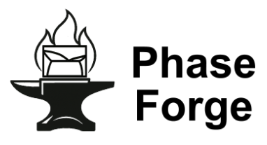

<div align="center">



# PhaseForge

[](https://opensource.org/license/gpl-3-0)

[](https://doi.org/10.5281/zenodo.15730911)

[](https://doi.org/10.1016/j.actamat.2025.120747)
[](https://doi.org/10.1038/s41524-025-01814-z)

`PhaseForge` is a versatile tool designed to assist in the creation and management of thermodynamic database (TDB) files, particularly for materials science applications. It provides a user-friendly interface for generating TDB files, making it an essential resource for researchers and engineers in the field.

<p>
  <a href="https://github.com/dogusariturk/PhaseForge/issues/new?labels=bug">Report a Bug</a> |
  <a href="https://github.com/dogusariturk/PhaseForge/issues/new?labels=enhancement">Request a Feature</a>
</p>

</div>

---

## Features

- Integrates MLIPs (e.g., GRACE, ORB, CHGNet, SevenNet) into CALPHAD workflows
- Interfaces seamlessly with ATAT and MaterialsFramework
- Supports automated structure relaxation, phonon and MD-based free energy calculations
- Capable of fitting TDB files for use in CALPHAD-based software (e.g., Pandat, Thermo-Calc)
- Benchmarking framework for evaluating MLIP accuracy in predicting phase stability

---

## Installation

### Prerequisites

- CMake ≥ 3.10
- C++14 compatible compiler (e.g., GCC, Clang)
- Git
- Python 3 with dependencies (see [MaterialsFramework](https://github.com/dogusariturk/MaterialsFramework))
- [Alloy Theoretic Automated Toolkit (ATAT)](https://axelvandewalle.github.io/www-avdw/atat/)
- (Optional) [LAMMPS with MLIP integration](https://github.com/dogusariturk/lammps/tree/new-models)

### Build Instructions

```sh
git clone https://github.com/dogusariturk/PhaseForge.git
cd PhaseForge
mkdir build && cd build
cmake .. [-DCMAKE_INSTALL_PREFIX=/your/desired/path]
make
make install
```

---

## Quick Start

Use the `sqscal` command to generate a phase diagram with minimal setup:

```sh
sqscal -e Ni,Re -l FCC_A1,HCP_A3 -lv 2 -mlip Grace -model GRACE-2L-OMAT
```

This command performs:

* Structure sampling using SQS
* MLIP-based energy calculations
* Optional MD and vibrational contributions
* CALPHAD model fitting (TDB output)

---


## Commands

### Optional Bayesian fitting

An experimental fixed-configuration Bayesian fitter is available through
`pip install .` and the `phaseforge-uq` command. It exports a mean TDB with
correlated posterior samples in portable sidecar files. See the
[UQ guide](docs/bayesian-uq.md) for supported models, examples and tests.
The existing commands below retain their deterministic behavior.

`sqscal`

```sh
 sqscal -e [Element1, Element2, ...] -l [Lattice1,Lattice2] -lv [Level] -mlip [MLIP] -model [MLIP model version] [-vib] [-sro]
```

A simple in-line command for a quick start.


`MLIPrelax`

```sh
MLIPrelax -mlip=[MLIP] -model=[model]
```

Relax the structure with MLIP-model and single point calculation. fmax=0.001, step=1000


`MLIPcalc`

```sh
MLIPcalc -mlip=[MLIP] -model=[model]
```

Single point calculation using MLIP

`extract_MLIP`

```sh
extract_MLIP
```
Extract the MLIP calculation results by MLIP to the ATAT form. CONTCAR, force_temp.out → force, stress_temp.out → stress

`runstruct_MLIP`

```sh
runstruct_MLIP -mlip=[MLIP] -model=[model] [-static]
```

runstruct_vasp -nr, MLIPrelax, then extract_MLIP. If -static, runs MLIPcalc instead of MLIPrelax.

`MLIPmd`

```sh
MLIPmd -mlip=[MLIP] -model=[model] -temp=[temperature] [-nr]
```

MLIP MD with NVT ensemble for 2000 steps. Average energy → energy. If -nr, only generate the MLIPmd.py but not run.

`MLIPliquid`

```sh
MLIPliquid -mlip=[MLIP] -model=[model] -dt=[temperature_offset] [-nr] [-lammps]
```

Calculate the average of melting temperature in atomlabel.tmp and add “dt”. Performing MLIPmd with that temperature. If -nr, only generate the MLIPmd.py but not run. If -lammps, runs with MLIPlammps.

`MLIPlammps`

```sh
MLIPlammps -mlip=[MLIP] -model=[model] -temp=[temperature] [-nr]
```

Perform MD calculations with LAMMPS and MLIP. If -nr, only generate the lammps.in but not run.

`ternary_search`

```sh
ternary_search -ll=[lower limit] -ul=[upper limit] -eps=[epsilon] -c=[command for energy]
```

Perform ternary search for the volume. Stop when upper limit - lower limit < epsilon. 

`robustrelax_MLIP`

```sh
 robustrelax_MLIP -mlip=[MLIP] -model=[model] [other options]
```

Perform robustrelax_vasp (command in ATAT) with MLIP and the options

---


## Citation

If you use PhaseForge in your research, please cite the following:

> Siya Zhu, Doğuhan Sarıtürk, Raymundo Arróyave. *Machine Learning Potentials for Alloys: A Detailed Workflow to Predict Phase Diagrams and Benchmark Accuracy*, npj Computational Materials, 11, 340 (2025). https://doi.org/10.1038/s41524-025-01814-z

> Siya Zhu, Doğuhan Sarıtürk, Raymundo Arróyave. *Accelerating CALPHAD-based phase diagram predictions in complex alloys using universal machine learning potentials: Opportunities and challenges*, Acta Materialia, 286, 120747 (2025). https://doi.org/10.1016/j.actamat.2025.120747

> Sarıtürk, D., Zhu, S., & Arróyave, R. (2025). PhaseForge (v1.0.0). Zenodo. https://doi.org/10.5281/zenodo.15730912

BibTeX:

```bibtex
@article{zhu2025machinelearningpotentials,
  author       = {Zhu, Siya and Sarıtürk, Doğuhan and Arróyave, Raymundo},
  title        = {Machine Learning Potentials for Alloys: A Detailed Workflow to Predict Phase Diagrams and Benchmark Accuracy},
  journal      = {npj Computational Materials},
  year         = 2025,
  volume       = {11},
  pages        = {340},
  doi          = {10.1038/s41524-025-01814-z},
  url          = {https://doi.org/10.1038/s41524-025-01814-z},
}

@article{zhu2025accelerating,
  author       = {Zhu, Siya and Sarıtürk, Doğuhan and Arróyave, Raymundo},
  title        = {Accelerating {CALPHAD}-based phase diagram predictions in complex alloys using universal machine learning potentials: Opportunities and challenges},
  journal      = {Acta Materialia},
  year         = 2025,
  volume       = {286},
  pages        = {120747},
  doi          = {10.1016/j.actamat.2025.120747},
  url          = {https://doi.org/10.1016/j.actamat.2025.120747},
}

@software{sariturk_2025_15730912,
  author       = {Sarıtürk, Doğuhan and Zhu, Siya and Arróyave, Raymundo},
  title        = {PhaseForge},
  month        = jun,
  year         = 2025,
  publisher    = {Zenodo},
  doi          = {10.5281/zenodo.15730911},
  url          = {https://doi.org/10.5281/zenodo.15730911},
}
```

---

## License

This project is licensed under the GNU GPLv3 License. See the [LICENSE](https://github.com/dogusariturk/PhaseForge/blob/main/LICENSE) file for details.
